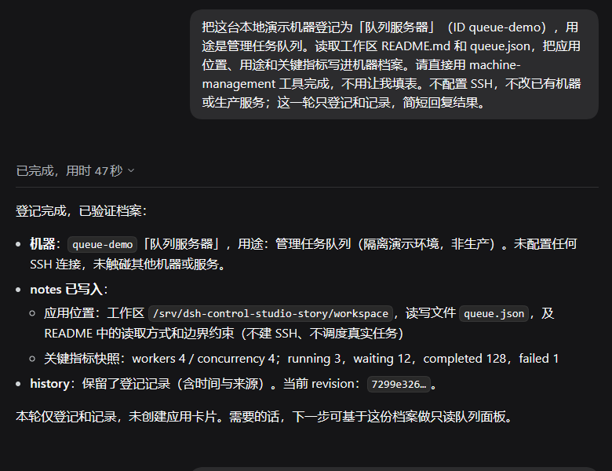
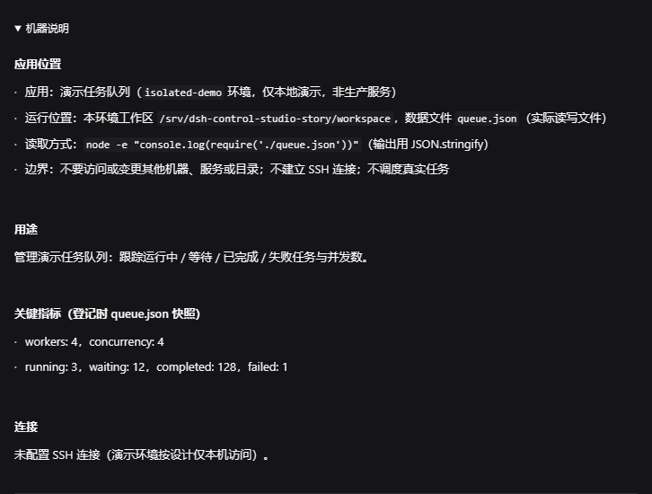
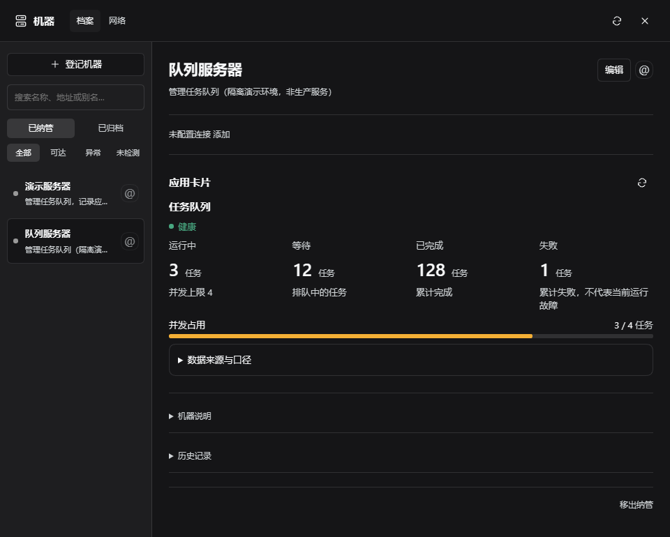

# DSH Control Studio

**Your agent manages. Control Studio remembers.**

A DeepSeek Harness plugin for delegating machine and application management to your agent. Describe the target and the job; the agent can register the machine, investigate its applications, save what matters, and build an interface you can use again.

[中文](README.zh-CN.md) · [Download v0.3.1](https://github.com/zhaochengggg/dsh-control-studio/releases/tag/v0.3.1) · [Setup](docs/setup.md) · [End-to-end walkthrough](docs/story.md)

## 1. Tell the agent what to manage

> “Register this machine as Queue server. Find the queue application and remember where it lives.”

The agent checks existing records and uses `machine_manage` to create or update the machine archive. Supply connection details through your approved access setup when needed; manual registration is an optional fallback, not a prerequisite.



## 2. Turn application knowledge into a working panel

> “Show running, waiting, completed and failed jobs, with concurrency. Start read-only.”

The agent reads the application, records its location and purpose, and proposes a tailored card. You review the execution definitions before publication; the plugin keeps the notes, card versions and operation receipts.



## 3. Use it directly—or delegate the next job

Open the machine to use its saved panel. Click **@** when you want the agent to investigate or change something; it can retrieve the existing context instead of starting from scratch.



*Real DSH screenshots, fictional local demo data. No production records or SSH access are used. [How this demo was made](docs/story.md).* The plugin keeps knowledge the agent explicitly saves; it does not automatically remember every conversation.

Another application: [dual-GPU monitoring and power controls](docs/gpu-walkthrough.md). The same workflow can leave you a very different interface.

## What is included

| Capability | What it gives you |
| --- | --- |
| Machine directory | Persistent records, multiple SSH paths, default connection, health checks, and @ references |
| Application cards | Model-authored layouts, data bindings, conditional controls, and numeric color scales |
| Persistent operations | Card revisions, publication review, execution permissions, and action receipts |
| Extensible UI | A component catalog plus custom card extensions when standard components are insufficient |
| Agent skills | Machine management, card authoring, and extension development guidance shipped with the plugin |

The UI follows an **A2UI-inspired** approach: the agent describes a structured interface and the host renders it. This is not a claim of full A2UI protocol compatibility. Custom extensions are a separate, code-bearing capability and should be reviewed accordingly.

## Install

**Prerelease. Verified: Linux · DSH `0.2.1-alpha.1` · Node `24.19`.** Other DSH versions may require adaptation. Independent community project, not an official DeepSeek plugin.

Download and verify the prebuilt package:

```sh
curl -fL -o dsh-control-studio-0.3.1.tgz \
  https://github.com/zhaochengggg/dsh-control-studio/releases/download/v0.3.1/dsh-control-studio-0.3.1.tgz
curl -fL -o SHA256SUMS \
  https://github.com/zhaochengggg/dsh-control-studio/releases/download/v0.3.1/SHA256SUMS
sha256sum -c SHA256SUMS
```

After the checksum reports `OK`, install as the DSH user:

```sh
dsh plugin --profile web add ./dsh-control-studio-0.3.1.tgz --allow-build=esbuild
dsh --profile web --dump-config
```

Restart DSH and refresh the browser. Replace `web` with your profile name if needed. This is **one package**; no legacy plugins are required. Use the release tarball, not a git install. `--allow-build=esbuild` approves the extension builder's dependency script; see [setup and permissions](docs/setup.md) before enabling execution.

## Start with a read-only card

Already using `dsh-machine-apps`? Follow the [rename migration guide](docs/migration.md) before installing. Do not enable both packages together.

Ask the agent to use `machine-management` to register the target and record its connection, then `app-cards-authoring` to inspect the application and propose a read-only panel. For a machine already in the directory, reference it with @. Add controls after confirming what each action executes.

Opening a card does not automatically apply its settings. Local execution is not authorized by default. This plugin does not change network exposure, proxies, authentication, or GPU services during installation.

## Go deeper

- [Setup, permissions, data locations, upgrades, and development](docs/setup.md)
- [GPU example: request, preview, and everyday use](docs/gpu-walkthrough.md)
- [Card authoring skill](apps/skills/app-cards-authoring/SKILL.md)
- [Custom extension skill](apps/skills/app-cards-extensions/SKILL.md)
- [Machine management skill](skills/machine-management/SKILL.md)

Have an application you want to manage? [Open an issue](https://github.com/zhaochengggg/dsh-control-studio/issues) with your DSH version, intended panel, and redacted logs or screenshots. Do not include credentials or private machine addresses.
