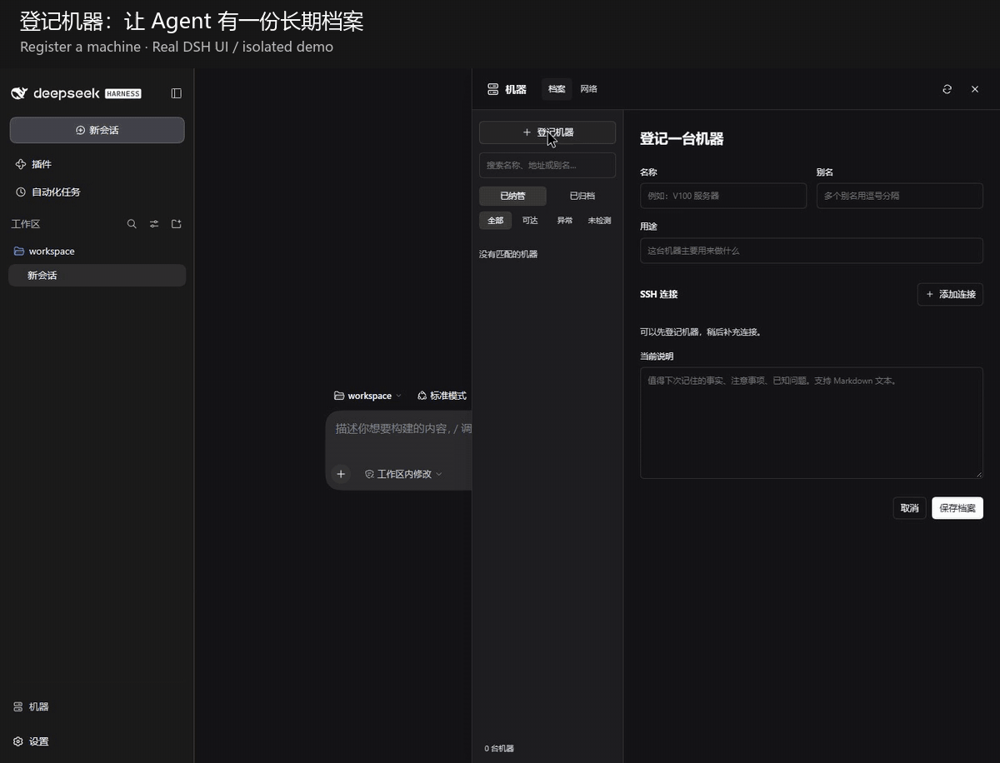

# DSH Control Studio

**Your agent manages. Control Studio remembers.**

A DeepSeek Harness plugin that gives your agent a lasting place for machines, application knowledge, and everyday controls. Register a machine, bring it into a conversation with @, and ask the agent to manage its applications. Keep the records and panels after the conversation ends.

[中文](README.zh-CN.md) · [Download v0.3.1](https://github.com/zhaochengggg/dsh-control-studio/releases/tag/v0.3.1) · [Setup](docs/setup.md) · [End-to-end walkthrough](docs/story.md)



*Real DSH UI in a separate demo environment. Example machine and task-queue data; no production records. Edited recording with an approval screenshot; generation waits shortened. See [recording details](docs/story.md).*

## From a machine to an ongoing working relationship

1. **Register the machine.** Give it a name and purpose. Add SSH connection details when needed, or register first and connect later. The directory keeps the machine identity and connection choices together.
2. **Bring it into the conversation.** Click @ on the machine. The agent can use the plugin tools to retrieve its notes and connections instead of asking you to repeat them.
3. **Delegate application work.** Ask the agent to inspect an application, document its configuration, diagnose a problem, or propose a monitoring panel. The agent uses its tools and your granted access; the plugin keeps records it explicitly saves.
4. **Review the result.** Inspect the proposed UI and approve its execution definitions. A generated button is not permission to run arbitrary commands.
5. **Come back and continue.** Use the saved panel directly, or @ the same machine in another conversation. Machine notes, important history, card revisions, and action receipts remain available.

> “Manage the task queue on this machine. Remember where it lives and show me running, waiting, completed, and failed jobs in a panel.”

The agent does the reasoning and application work. Control Studio supplies the persistent machine context and UI. It does not automatically archive every conversation or grant unrestricted access.

For a second real-world example, see the [dual-GPU monitoring and power-control panel](docs/gpu-walkthrough.md).

## What is included

| Capability | What it gives you |
| --- | --- |
| Machine directory | Persistent records, multiple SSH paths, default connection, health checks, and @ references |
| Application cards | Model-authored layouts, data bindings, conditional controls, and numeric color scales |
| Persistent operations | Card revisions, publication review, execution permissions, and action receipts |
| Extensible UI | A component catalog plus custom card extensions when standard components are insufficient |
| Agent skills | Machine management, card authoring, and extension development guidance shipped with the plugin |

The UI follows an **A2UI-inspired** approach: the agent describes a structured interface and the host renders it. This is not a claim of full A2UI protocol compatibility. Custom extensions are a separate, code-bearing capability and should be reviewed accordingly.

## Install

**Prerelease. Verified: Linux · DSH `0.2.1-alpha.1` · Node `24.19`.** Other DSH versions may require adaptation. Independent community project, not an official DeepSeek plugin.

Download and verify the prebuilt package:

```sh
curl -fL -o dsh-control-studio-0.3.1.tgz \
  https://github.com/zhaochengggg/dsh-control-studio/releases/download/v0.3.1/dsh-control-studio-0.3.1.tgz
curl -fL -o SHA256SUMS \
  https://github.com/zhaochengggg/dsh-control-studio/releases/download/v0.3.1/SHA256SUMS
sha256sum -c SHA256SUMS
```

After the checksum reports `OK`, install as the DSH user:

```sh
dsh plugin --profile web add ./dsh-control-studio-0.3.1.tgz --allow-build=esbuild
dsh --profile web --dump-config
```

Restart DSH and refresh the browser. Replace `web` with your profile name if needed. This is **one package**; no legacy plugins are required. Use the release tarball, not a git install. `--allow-build=esbuild` approves the extension builder's dependency script; see [setup and permissions](docs/setup.md) before enabling execution.

## Start with a read-only card

Already using `dsh-machine-apps`? Follow the [rename migration guide](docs/migration.md) before installing. Do not enable both packages together.

Open the machine panel, register a machine, and attach it with @. Ask the agent to use the bundled `machine-management` and `app-cards-authoring` skills to inspect the target and propose a read-only panel first. Add controls after confirming what each action executes.

Opening a card does not automatically apply its settings. Local execution is not authorized by default. This plugin does not change network exposure, proxies, authentication, or GPU services during installation.

## Go deeper

- [Setup, permissions, data locations, upgrades, and development](docs/setup.md)
- [GPU example: request, preview, and everyday use](docs/gpu-walkthrough.md)
- [Card authoring skill](apps/skills/app-cards-authoring/SKILL.md)
- [Custom extension skill](apps/skills/app-cards-extensions/SKILL.md)
- [Machine management skill](skills/machine-management/SKILL.md)

Have an application you want to manage? [Open an issue](https://github.com/zhaochengggg/dsh-control-studio/issues) with your DSH version, intended panel, and redacted logs or screenshots. Do not include credentials or private machine addresses.
