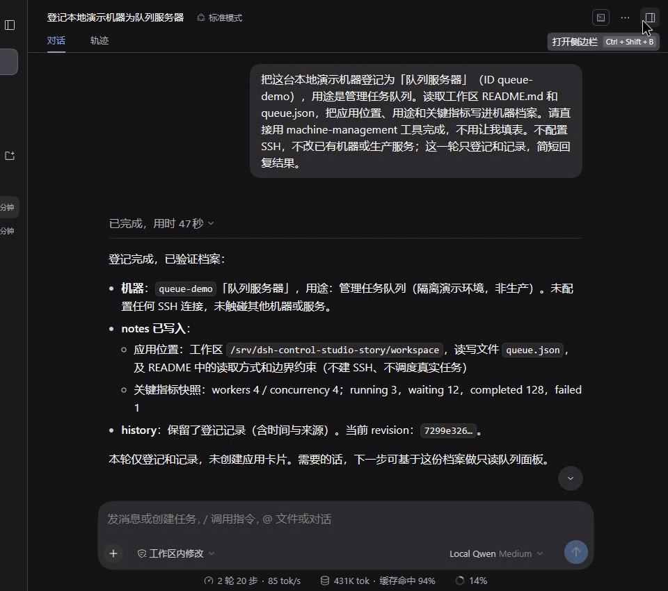
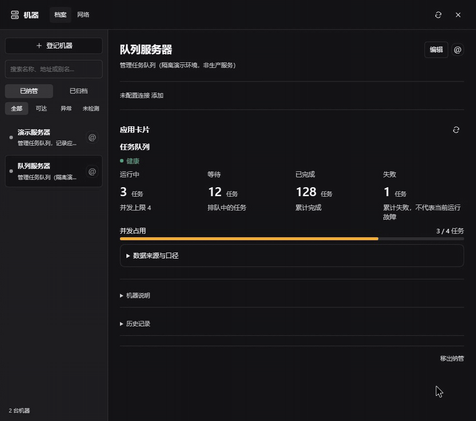
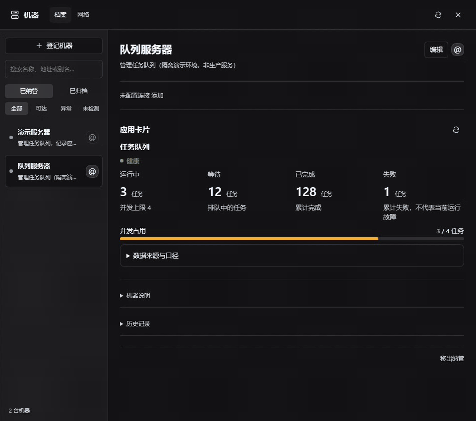

# DSH A2UI Studio

**你的机器与应用，由 Agent 管理，由 A2UI Studio 记住。**

把机器和应用交给 DeepSeek Harness 中的 Agent 管理。你交代目标与需求，Agent 可以完成机器登记、应用调查、知识记录和专属界面生成；插件把这些成果留给下一次使用。

[English](README.md) · [下载 v0.3.1](https://github.com/zhaochengggg/dsh-a2ui-studio/releases/tag/v0.3.1) · [安装与维护](docs/setup.zh-CN.md) · [完整使用故事](docs/story.md)

## 1. 交代目标，Agent 完成纳管

> “把这台机器登记为队列服务器，看看任务队列放在哪里，帮我记下来。”

Agent 查重后调用 `machine_manage` 登记或更新档案。需要远程访问时，通过已有的安全访问配置提供连接信息；手动填表只是备用入口，不是使用前提。



*8 秒：从 Agent 已完成的登记结果，打开机器档案。*

## 2. 理解应用，留下专属工作界面

> “做一个只读面板，让我看到运行中、等待、完成、失败和并发占用。”

Agent 读取应用、记录用途与位置，再提出适合这个应用的卡片。你审阅执行定义后发布，插件保存说明、卡片版本和操作回执。



*8 秒：展开应用说明，回到卡片刷新状态。*

## 3. 平时直接用，需要时继续委托

打开机器就能使用已保存的面板。需要调查或调整时，点击 **@** 把机器带入对话，Agent 可以读取已有档案，不必每次重新交代环境。



*7.5 秒：点击 @ 带入对话，没有提交新请求。*

*三段真实 DSH 短录屏，使用虚构的本地演示数据；回看已完成的结果，不冒充实时生成。[说明与静态图](docs/story.md)。* 插件保留 Agent 明确写入的知识，不是自动记住所有聊天。

另一个应用案例：[双 GPU 监控与功耗控制](docs/gpu-walkthrough.md)。同样的管理方式，可以留下完全不同的工作界面。

## 一个包里有什么

| 能力 | 用途 |
| --- | --- |
| 机器目录 | 持久化记录、多条 SSH 连接、默认路径、连接探测与 @ 引用 |
| 应用卡片 | 模型编写布局、数据绑定、条件控件与连续数值色阶 |
| 持久化操作 | 卡片修订、发布审核、执行授权与操作回执 |
| UI 扩展 | 标准组件不够时，使用自定义卡片扩展 |
| 配套 skills | 教模型如何管理机器、编写卡片、开发扩展与验证真实界面 |

这是 **A2UI-inspired** 的实现：模型描述结构化界面，宿主负责渲染；并不宣称完整兼容 A2UI 协议。自定义扩展包含代码，需要单独审查，不能等同于纯声明式布局。

## 安装

原名 DSH Control Studio。安装包和插件标识暂时保留 `dsh-control-studio`，保证已有安装兼容；本次展示名称变更无需迁移数据或重新安装。

**当前为预发布版。已验证 Linux、DSH `0.2.1-alpha.1`、Node `24.19`。** 其他 DSH 版本可能需要适配。非 DeepSeek 官方插件。

先下载并校验：

```sh
curl -fL -o dsh-control-studio-0.3.1.tgz \
  https://github.com/zhaochengggg/dsh-a2ui-studio/releases/download/v0.3.1/dsh-control-studio-0.3.1.tgz
curl -fL -o SHA256SUMS \
  https://github.com/zhaochengggg/dsh-a2ui-studio/releases/download/v0.3.1/SHA256SUMS
sha256sum -c SHA256SUMS
```

确认输出 `OK` 后，以运行 DSH 的用户安装：

```sh
dsh plugin --profile web add ./dsh-control-studio-0.3.1.tgz --allow-build=esbuild
dsh --profile web --dump-config
```

重启 DSH、刷新浏览器。`web` 按实际 profile 名称替换。只需这一个包，不需要旧的两个插件。当前使用预构建 tgz 分发，不要直接用 git 安装；尚未发布 npm 包。`--allow-build=esbuild` 仅批准扩展构建器需要的依赖脚本。

## 第一次建议先做只读面板

已经安装 `dsh-machine-apps` 的用户，请先阅读[改名迁移说明](docs/migration.md)，不要同时启用两个包。

让 Agent 使用 `machine-management` 登记机器并记录连接，再用 `app-cards-authoring` 检查目标应用、提出只读卡片。已有机器可以直接 @ 到对话。确认数据来源和显示正确后，再添加操作按钮。

本地执行默认未授权；远程操作使用登记的 SSH 身份。打开卡片不会自动应用设置。安装插件也不会修改网络开放、代理、认证或 GPU 服务。目录白名单、数据路径、备份与升级见[安装与维护](docs/setup.zh-CN.md)。

想接入自己的应用？欢迎[提交 issue](https://github.com/zhaochengggg/dsh-a2ui-studio/issues)，说明 DSH 版本、想要的面板和脱敏后的错误信息。不要上传凭据或私有机器地址。
