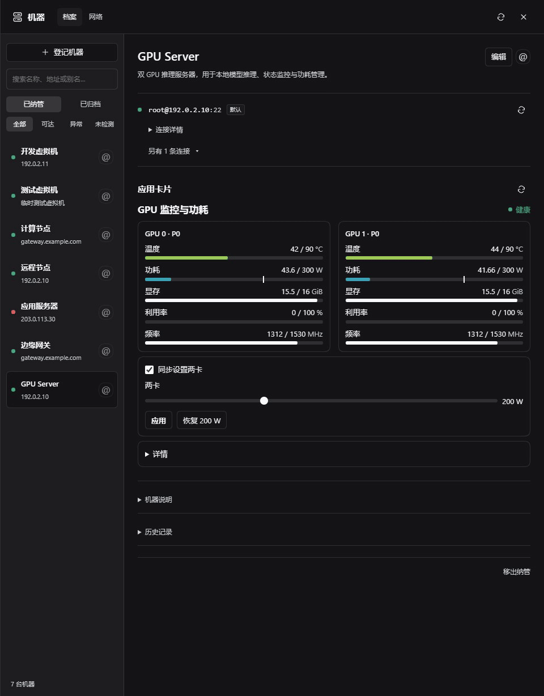
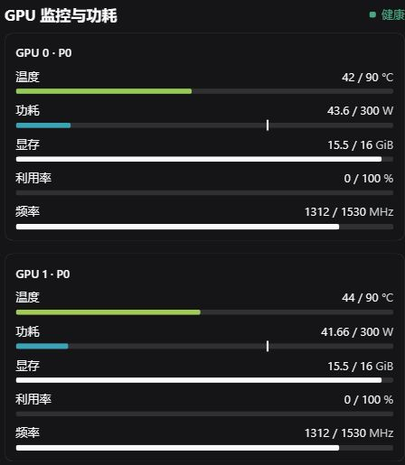
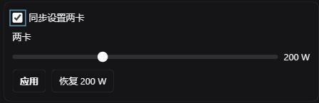

# A panel for a dual-GPU inference machine

[Overview](../README.md) · [中文首页](../README.zh-CN.md)

This example comes from a real dual-V100 inference server. One GPU has less thermal headroom than the other. A useful panel should make differences visible and let the operator adjust both devices together or independently.

The looping GIF edits real UI captures into a side-by-side walkthrough. Telemetry is a captured snapshot; the control states show synchronized → independent → synchronized mode. No power-setting action was submitted. It is not an uninterrupted screen recording.

## 1. Describe the job

Register the machine and attach it to the conversation. An example request:

> Use the machine-management and app-cards-authoring skills. First inspect the GPUs read-only. Propose a persistent panel comparing temperature, power, memory use, utilization, and clock speed for both GPUs, with explicit units. Use each device's physical power limit as the gauge maximum, and mark the configured limit separately. Make thermal pressure visible. Add a “set both GPUs together” checkbox and power sliders, but do not change any settings before I review the actions and permissions. Show the real card preview before publishing.

This is a starting prompt, not a guaranteed one-shot generator. Verify available telemetry, hardware limits, commands, and permissions for the actual machine. Do not copy this server's numerical limits to unrelated hardware.

## 2. Review the rendered card

Actual running card, captured on 2026-10-16—not a mockup or benchmark. The crop excludes host addresses and conversations. Its interface language is Chinese:

| Label | Meaning |
| --- | --- |
| 温度 / 功耗 | Temperature / power draw |
| 显存 / 利用率 / 频率 | GPU memory / utilization / clock |
| 同步设置两卡 | Set both GPUs together |
| 应用 / 恢复 200 W | Apply / restore this example's 200 W setting |

Check units, ranges, missing-data states, narrow layouts, and what each action executes in the real renderer. The screenshot shows a normal state; it is not evidence that every failure state has been exercised.

## 3. Use it after the conversation

Return to the machine's applications section to inspect readings and refresh status. With execution permissions approved, use the controls to apply a setting and inspect its receipt. Card publication and command execution have separate review boundaries.

The reusable pattern is **machine context → application-specific UI → reviewed actions → persistent panel**. Other applications need their own observations, commands, and controls; this GPU card is not installed as a universal template.

## 中文：从需求到日常使用

这台双 V100 的两卡散热余量不同，所以面板围绕“并排比较、看出异常、同时或分别调节”设计。先让模型只读检查，再提出卡片；预览真实组件，核对单位、物理量程、空值与操作命令，最后审核发布和执行权限。

卡片留在机器的应用区域，之后直接使用，不必每次重新询问模型。截图中的 200 W 是这台机器的配置，不是对其他硬件的推荐值。这里展示使用方式，不提供可远程操作的公共在线演示。
