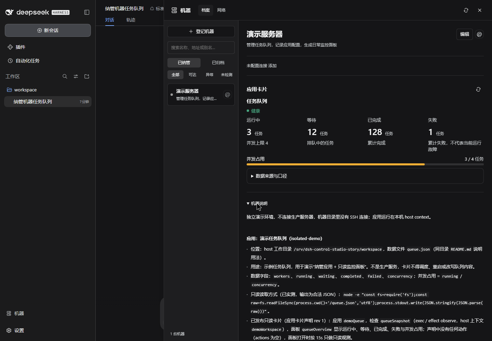
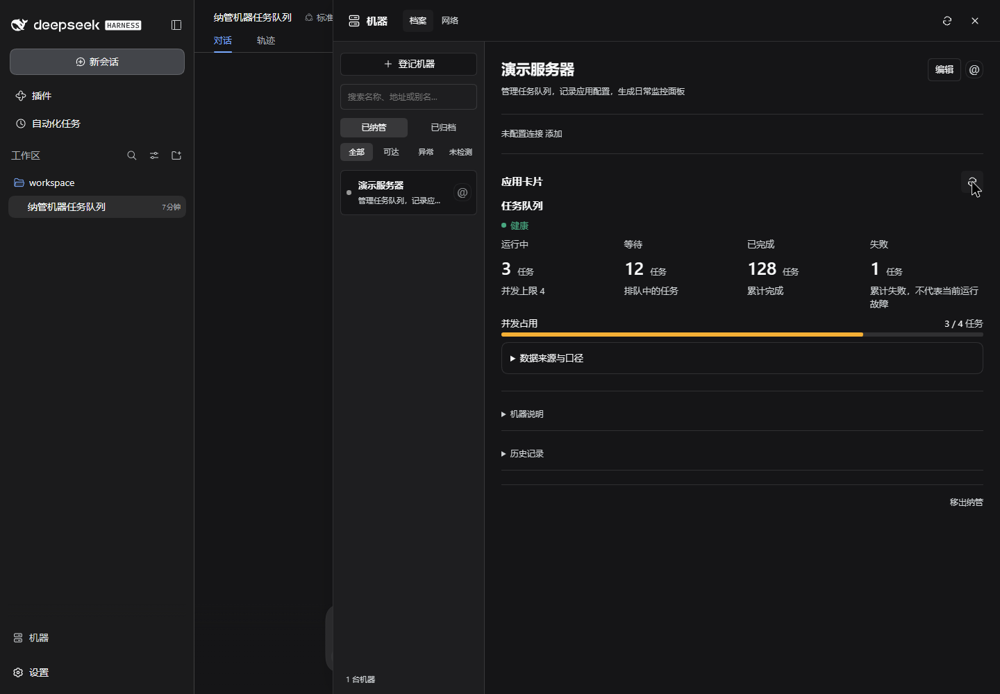

# From a machine to a working interface

[English overview](../README.md) · [中文首页](../README.zh-CN.md)

Control Studio gives an agent somewhere to keep machine knowledge and somewhere to leave useful application interfaces. The workflow starts with a machine, not a dashboard template.

## 1. Register the machine

Open **Machines → Register machine**. Give it a name and a purpose. Add an SSH connection when remote access is needed; an inventory entry can also exist without one. Registration records an identity—it does not deploy software or grant unrestricted access.

In this recording, **演示服务器** (“Demo server”) manages a small example task queue in an isolated local workspace. No SSH connection is configured. For a real remote application, register its actual SSH connection and verify the host identity before asking the agent to work on it.

## 2. Bring it into the conversation

Click **@** on the machine. The reference identifies which machine the agent should inspect with the plugin's tools. You can then describe the job in ordinary language:

> Read this application's documentation and queue data. Record its purpose and location in the machine's notes. Build a read-only card showing running, waiting, completed and failed jobs, plus concurrency. Propose it for review before publishing.

The demo additionally tells the agent to use the bundled `machine-management` and `app-cards-authoring` skills, use the isolated host context, and leave production services untouched.

## 3. Let the agent do the application-specific work

The agent reads `README.md` and `queue.json`, updates the machine notes, and authors a card declaration with a read probe and data bindings. Those steps happen in the actual DSH conversation; they are not a scripted chat transcript.

This is where different applications diverge. A queue needs counts; an inference server needs GPU telemetry and power controls; a service may need a health check and restart action. The plugin supplies records, rendering and review boundaries. The agent still has to understand the application and verify its proposed commands.

## 4. Review before use

Inspect the proposed card and the operations it defines. Publication and execution permissions are distinct. Start with read-only observation; add write actions only when their scope and consequences are clear.

In this run, validation caught missing schema fields before publication. After reviewing the real first render, we asked for a UI-only refinement: a clearer title, compact status, and no whole-card alarm for a historical failure count. The final panel is revision 2; its read operation and execution permissions are unchanged. The demo is an actual reviewed workflow, not a guaranteed first-draft result.

## 5. Come back without starting over

The machine notes and published card live beyond the conversation. Reopen the machine to inspect the application, or @ it in another conversation to continue work. The plugin retains explicitly saved knowledge; it does not silently turn every message into machine documentation.

## 中文：一次委托，留下下次可用的工作界面

**登记机器 → @ 给 Agent → 理解应用并记录 → 审阅卡片 → 日常直接使用。**

登记时写清名称、用途；远程机器再添加 SSH 连接。点击机器上的 @ 把目标带入对话，让 Agent 读取应用、记录位置和配置、提出专属界面。确认数据来源与权限之后，卡片就留在机器下；下一次既可以直接看面板，也可以继续让 Agent 处理问题。

这次用“任务队列”串起完整过程。另一个更接近日常运维的案例是[双 GPU 监控与功耗控制](gpu-walkthrough.md)。

## Recording boundaries

- Recorded in real DSH with Playwright CLI, using a separate DSH home, plugin copy and demo workspace.
- Names and data are fictional from the start. Production machines, conversations and cards were not copied into the demo.
- The agent actually reads the example files and authors the card. The GIF combines edited screen recordings with a labeled screenshot of the actual approval prompt. Generation and troubleshooting waits are shortened; it is not a real-time speed benchmark or a promise of one-shot generation.
- The demo process has a read-only system filesystem, a hidden production home directory, and write access limited to its own demo tree. The application is a local JSON fixture, not a production queue or an SSH connectivity test.
- The separate [GPU recording](gpu-walkthrough.md) shows a previously deployed control panel; it is not presented as the output of this queue conversation.

The demo does not require changing your production records to follow along. Use your own test machine and a small read-only application first.
